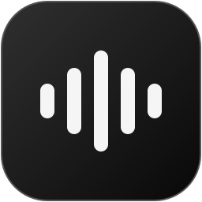

<h1 align="center">Onda</h1>

Un lettore musicale per Windows: minimale, fluido e senza account.

  <a href="https://github.com/VoidAle/Onda/releases/latest/download/Onda-Setup.exe"><b>Scarica Onda</b></a> ·
  <a href="https://github.com/VoidAle/Onda/releases/latest">Novità</a> ·
  <a href="https://discord.gg/SE4Q9gt3j">Segnala un bug</a>

---

## Installazione

1. Scarica **[Onda-Setup.exe](https://github.com/VoidAle/Onda/releases/latest/download/Onda-Setup.exe)**.
2. Aprilo e segui la procedura: Onda si installa per il tuo utente, senza permessi di amministratore, e compare nel menu Start.
3. Non serve installare altro. Per disinstallare: *Impostazioni → App → Onda*.

Preferisci la versione portatile? Nella [pagina della release](https://github.com/VoidAle/Onda/releases/latest) c'è anche lo ZIP: estrailo e avvia **Onda.exe**.

**Requisiti:** Windows 10 o 11 a 64 bit e una connessione Internet. La beta non è firmata digitalmente, quindi Windows può mostrare un avviso di SmartScreen: scegli *Ulteriori informazioni → Esegui comunque*.

**Aggiornare:** dalla 0.2.0 Onda si aggiorna da sola: quando c'è una nuova versione premi *Scarica aggiornamento*, Onda controlla il pacchetto e si riavvia aggiornata. Playlist, preferiti e impostazioni restano al loro posto. Il controllo automatico si disattiva in *Impostazioni → Aggiornamenti*. Le beta precedenti alla 0.2.0 non si aggiornano da sole: installa con **Onda-Setup.exe**, i tuoi dati restano.

## Windows blocca il file?

Se compare «Un criterio di controllo delle applicazioni ha bloccato questo file» o «estensione di file pericolosa dal web»:

1. Non scaricare né spostare **Onda.exe** da solo: usa **Onda-Setup.exe** (o lo **ZIP** della release).
2. Prima di aprirlo: tasto destro su **Onda-Setup.exe** (o sullo ZIP) → **Proprietà** → spunta **Sblocca** → OK. Con lo ZIP, poi **Estrai tutto**.
3. Con lo ZIP, avvia **Onda.exe** dalla cartella estratta, senza copiarlo altrove (crea un collegamento sul Desktop con tasto destro → *Invia a → Desktop*).
4. In alternativa, da PowerShell nella cartella del download: `Get-ChildItem Onda-Setup.exe, *.zip | Unblock-File`.

La beta non è firmata digitalmente (la firma richiede un certificato a pagamento): con **Smart App Control** attivo Windows può comunque bloccare programmi non firmati; in quel caso l'unica via è disattivarlo in *Sicurezza di Windows → Controllo app e browser → Smart App Control*.

## Cosa fa

- **Cerca** brani, artisti, album e playlist nel catalogo YouTube Music, anche mentre scrivi.
- **Ascolta** con coda, casuale, ripetizione e suggerimenti simili che continuano la musica quando finisce la playlist.
- **Vista di ascolto** con copertina grande, testo sincronizzato quando disponibile (un clic su una riga porta la canzone a quel punto).
- **Radio e mix**: avvia una radio da qualsiasi brano e ascolta *Il tuo mix*, costruito sui tuoi ascolti. Nella pagina di un artista trovi gli artisti simili.
- **Mini-player** sempre in primo piano (Ctrl+M) e **tavolozza comandi** (Ctrl+K) per fare tutto da tastiera.
- **In sottofondo**: icona nell'area di notifica, musica che continua quando chiudi la finestra e avvio con Windows, se lo vuoi.
- **Backup e ripristino** di playlist, preferiti, cronologia e impostazioni in un file ZIP.
- **Sondaggio iniziale**: scegli generi, artisti e brani e Onda crea la tua playlist *Per te*.
- **Playlist locali**: crea, riordina trascinando, cerca all'interno, rimuovi i duplicati, scegli un'immagine, condividi con un link `onda://`, un codice o un file `.onda`.
- **SoundCloud**: cerca e ascolta anche da SoundCloud, con il filtro dedicato o incollando il link di un brano o di un intero set (playlist).
- **I miei brani**: carica i tuoi file audio dal computer (pulsante *Carica brani* o trascinandoli sulla finestra) e ascoltali come gli altri, anche senza Internet. Restano solo sul tuo PC, senza account.
- **Taglia inizio e fine** di qualsiasi brano dal menu **⋯**: utile per i caricamenti che partono dopo 30-40 secondi di silenzio. Il file non viene modificato.
- **Esporta file**: copia sul computer un brano scaricato o caricato, per modificarlo e ricaricarlo.
- **Importa** playlist da link Spotify e YouTube Music, da Apple Music e da file CSV, TXT o XML.
- **Trova da un file**: scegli una canzone dal computer e Onda la cerca dal titolo e dall'artista nel file, o ti propone brani simili.
- **Ascolto offline**: scarica brani o intere playlist e riproducili senza Internet. I brani SoundCloud che ascolti o salvi in playlist si scaricano da soli (disattivabile).
- **Wrapped**: i minuti realmente ascoltati e le classifiche di brani, artisti e album, per mese, anno o da sempre, con un'immagine da esportare e condividere.
- **Preferiti** e **Recenti**, timer di spegnimento, controlli multimediali di Windows e attività su Discord (disattivabile).
- **Temi**: Chiaro, Scuro, Oceano, Aurora, Foresta, Tramonto, Rosa, Lilla, Avana, Sabbia e uno personale con il colore che scegli. Interfaccia in italiano e inglese.

Per riprodurre un brano clicca sulla sua copertina; il resto della riga lo seleziona. Il menu **⋯** raccoglie le altre azioni. Con *Riduci le animazioni* (Impostazioni → Aspetto) ogni movimento viene disattivato.

## Importare una playlist

Apri **Playlist → Importa playlist**. Puoi provare con il [CSV di esempio](examples/playlist.csv).

| Origine | Come fare |
| --- | --- |
| Spotify | Incolla il link di una playlist pubblica, un album, un brano o un artista e premi **Apri link**. Non serve un account. Di una playlist Spotify mostra al massimo i primi 100 brani. |
| YouTube / YouTube Music | Incolla il link di una playlist pubblica o non in elenco e premi **Apri link**. |
| Altri servizi | Scegli un file CSV con le colonne `Titolo` e `Artista`. La durata è facoltativa. |
| Apple Music / iTunes | Scegli una playlist esportata in XML o TXT con titoli e artisti. |
| Testo semplice | Un file TXT con una riga `Artista - Titolo` per ogni brano. |

Onda cerca ogni titolo su YouTube Music e mostra le corrispondenze: quelle dubbie restano deselezionate e puoi controllarle a mano, mentre i brani non trovati compaiono nel riepilogo. Premendo **Importa** nasce una nuova playlist locale; la playlist di partenza e le tue playlist esistenti non vengono toccate.

I link di Apple Music non si importano direttamente: usa il file esportato. Nessun audio viene scaricato da Spotify o Apple Music, vengono lette solo le informazioni dei brani. Sono supportati file fino a 10 MB e playlist fino a 5.000 brani.

## Privacy

- Nessun account Onda e nessuna registrazione.
- Playlist, preferiti, cronologia, statistiche e impostazioni restano sul tuo computer, in `%LOCALAPPDATA%\OndaPlayer`.
- Ricerche, riproduzione e testi sono richieste ai rispettivi servizi esterni (YouTube Music, SoundCloud, LRCLIB). I link che importi vengono aperti su Spotify. Onda non invia altro.
- *Trova da un file* legge solo titolo, artista e durata dal file sul tuo computer e li usa per la ricerca: il file non viene inviato a nessuno.
- *I miei brani*: i file che carichi vengono copiati in `%LOCALAPPDATA%\OndaPlayer\uploads` e non vengono inviati a nessuno. Per la radio da un tuo brano Onda usa solo titolo e artista.
- *Impostazioni → Assistenza → Esporta rapporto errori* crea uno ZIP in locale, con versione, sistema e log recenti, senza dati della tua libreria. Non viene inviato da nessuna parte: controllalo prima di condividerlo.

## Segnalare un bug

Scrivimi sul [server Discord](https://discord.gg/SE4Q9gt3j) o in privato (ID `1007318097985798144`), anche da *Impostazioni → Segnala un bug su Discord*. Indica:

- la versione di Onda e di Windows;
- i passaggi per riprodurre il problema e cosa ti aspettavi;
- il titolo, l'artista o il link del brano, se riguarda riproduzione o testi;
- uno screenshot, se utile, senza dati personali.

## Limiti della beta

Catalogo, riproduzione e testi dipendono da servizi esterni: la disponibilità può cambiare e non tutti i brani hanno un testo sincronizzato. Su SoundCloud molte etichette offrono solo 30 secondi: quei brani non compaiono nella ricerca; dentro un set restano, segnalati. Onda non inventa i tempi mancanti. Sono possibili bug e rallentamenti di rete.

Questo repository distribuisce **il programma e la documentazione**: il codice sorgente non è pubblicato. I componenti di terze parti conservano le proprie licenze, incluse nello ZIP.

---

## English

**Onda** is a minimal, fluid Windows music player with no account required. It is currently in beta.

**Install:** from 0.2.0 on, Onda updates itself (*Download update* in the notice or in *Settings → Updates*). To install for the first time or move from an older beta, download and run **[Onda-Setup.exe](https://github.com/VoidAle/Onda/releases/latest/download/Onda-Setup.exe)**: it installs for your user only (no admin rights) and adds Onda to the Start menu. A portable ZIP is also on the [release page](https://github.com/VoidAle/Onda/releases/latest). Do not download or move **Onda.exe** on its own. Windows 10/11 (64-bit) and an Internet connection are required; no Python or Node.js needed. The beta is not code-signed, so SmartScreen may ask for confirmation (*More info → Run anyway*). If Windows says an app control policy blocked the file: right-click Onda-Setup.exe (or the ZIP) → *Properties* → *Unblock* **before** opening it. Your data stays in `%LOCALAPPDATA%\OndaPlayer`.

**Features:** search the YouTube Music catalogue, radio and a personal mix, similar artists, a floating mini player (Ctrl+M), a command palette (Ctrl+K), tray icon with background playback, backup and restore, experimental crossfade, queue and autoplay, an immersive listening view with synced lyrics and optional video, local playlists (reorder, search, de-duplicate, share with a code or a `.onda` file), *My tracks* (upload your own audio files, local only, drag and drop supported), per-track start/end trimming to skip long silences, file export, SoundCloud sets from a link (SoundCloud tracks you play or save are downloaded automatically, optional), playlist import from YouTube Music, Spotify, Apple Music and CSV/TXT/XML files, offline downloads, Wrapped listening statistics, favorites and history, sleep timer, Windows media controls, optional Discord activity, eleven themes and an Italian/English interface (*Settings → Language*). *Reduce animations* turns off all motion.

**Privacy:** no account, no telemetry. Library and settings stay on your computer. Searches, playback and lyrics go to the respective third-party services only, including SoundCloud; imported Spotify links are opened on Spotify. Files you pick for *Find from a file* or add to *My tracks* are never uploaded.

**Bugs:** report them on [Discord](https://discord.gg/SE4Q9gt3j) with the app version, Windows version, reproduction steps and the affected song or link.

This is a binary-only release: the source code is not published in this repository. Third-party components keep their own licenses, included in the ZIP.
